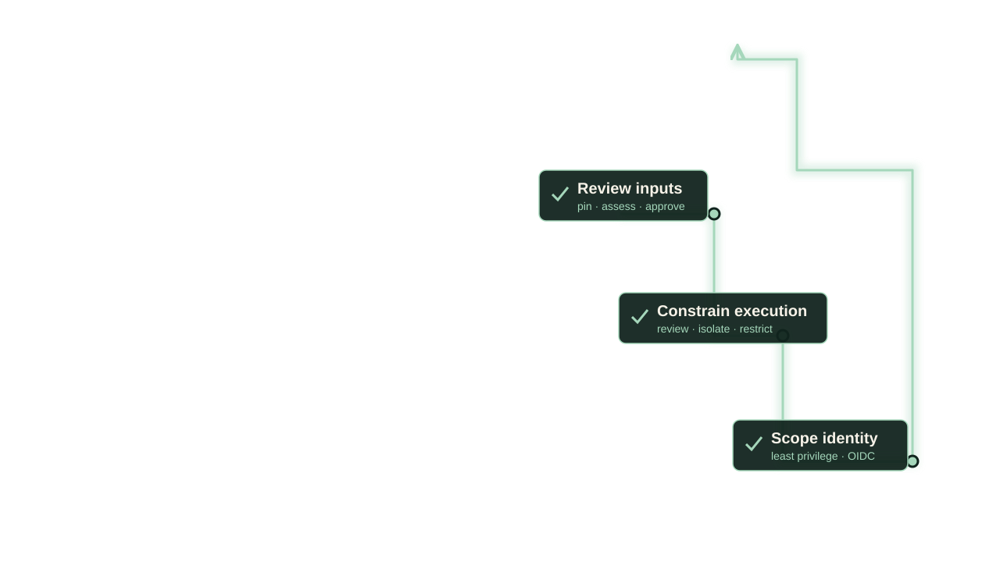

<!-- _class: closing-slide closing-cinematic safe chapter-controls neutral-title -->

<h1>You Trust More Code Than You Ship</h1>
Make that trust an engineering decision.

<a class="closing-qr closing-deck" href="https://npalm.github.io/supply-chain-security-talks/devcon26/" target="_blank" rel="noopener noreferrer">Slides + resources</a>

<b>Niek Palm</b><a href="https://github.com/npalm" target="_blank" rel="noopener noreferrer">github.com/npalm</a><a href="https://www.linkedin.com/in/niekpalm/" target="_blank" rel="noopener noreferrer">linkedin.com/in/niekpalm</a>

<!--
SLIDE 58 · SPEAKER NOTES

Say:
You trust more code than you ship. The hidden machinery is still there. Review what enters it, constrain what can execute, and scope the identity it can use. Make that trust an engineering decision. Scan for the deck and resources. Thank you.

Delivery:
Selected closing: the opening iceberg returns with three explicit trust checkpoints and a reviewed route toward the shipped application. Keep the same strong message. One large QR emphasizes the deck; LinkedIn appears as linkedin.com/in/niekpalm and both profiles remain clickable.
End prepared content here and leave this slide visible for questions. Timing is for rehearsal; timing.json remains the earlier baseline.

Next:
Take questions; use the catalogue only when useful.

Reference detail (not read aloud):
The image reuses the original opening artwork unchanged. A local SVG overlay adds conceptual review checkpoints and a bounded route. These illustrate engineering controls, not a verified architecture, complete remediation or a guarantee that the system is safe. All original hidden dependencies remain present.
Artwork and QR provenance: assets/artwork-closing-options-v1.json.
-->

---

<!-- _class: closing-slide closing-cinematic safe chapter-controls neutral-title -->

<h1>You Trust More Code Than You Ship</h1>
Make that trust an engineering decision.

<a class="closing-qr closing-deck" href="https://npalm.github.io/supply-chain-security-talks/devcon26/" target="_blank" rel="noopener noreferrer">Slides + resources</a>

<b>Niek Palm</b><a href="https://github.com/npalm" target="_blank" rel="noopener noreferrer">github.com/npalm</a><a href="https://www.linkedin.com/in/niekpalm/" target="_blank" rel="noopener noreferrer">linkedin.com/in/niekpalm</a>

---

<!-- _class: closing-slide closing-cinematic safe chapter-controls neutral-title -->

<h1>You Trust More Code Than You Ship</h1>
Make that trust an engineering decision.

<a class="closing-qr closing-deck" href="https://npalm.github.io/supply-chain-security-talks/devcon26/" target="_blank" rel="noopener noreferrer">Slides + resources</a>

<b>Niek Palm</b><a href="https://github.com/npalm" target="_blank" rel="noopener noreferrer">github.com/npalm</a><a href="https://www.linkedin.com/in/niekpalm/" target="_blank" rel="noopener noreferrer">linkedin.com/in/niekpalm</a>

